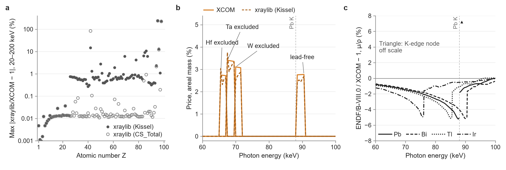

# Cross-section library sensitivity

*Each number keeps its source row of the headline table (`data/phase4b/headline_table_v3.csv`) in square brackets. Unless stated otherwise all values are narrow-beam, polymorph rule R2, coherent scattering included, frontier kind best_clean, and prices are B4-internal with thickness at the measured-density point.*

The map uses XCOM; xraylib (Schoonjans et al. 2011) and ENDF/B-VIII.0 (Brown et al. 2018) are used only as sensitivities (figure below).
Away from absorption edges the xraylib total cross sections reproduce XCOM closely, since both rest on the same underlying photoabsorption data.
Near the Hf, Ta, W and Pb K edges the edge-window prices are robust to the library choice, apart from narrow edge-step zones in which the xraylib Kissel tables are not tabulated data.
Just above the Pb K edge, ENDF/B-VIII.0 gives a higher Pb mass attenuation coefficient than XCOM, so the narrow-beam lead-free window is 2.2 % with ENDF/B-VIII.0 against 2.8 % with XCOM. [H121:hi, H63]

*Cross-section library sensitivity near absorption edges. (a) Largest relative difference between xraylib and XCOM elemental μ/ρ over 20–200 keV, per element (filled: Kissel photoelectric for Z ≥ 26; open: CS_Total). (b) Areal-mass prices near the Hf, Ta, W and Pb K edges with XCOM (solid) and xraylib-Kissel (dashed) cross sections: the element-exclusion filters for Hf, Ta and W, and the lead-free price in the Pb K-edge window (2.8 % with XCOM) [H63]. (c) ENDF/B-VIII.0 (the Monte Carlo library) against XCOM, μ/ρ of Pb, Bi, Tl and Ir. Triangles mark grid nodes where the two libraries place a K edge on different sides.*

## References

- Brown et al. 2018. ENDF/B-VIII.0: The 8th Major Release of the Nuclear Reaction Data Library with CIELO-project Cross Sections, New Standards and Thermal Scattering Data. Nuclear Data Sheets 148, 1-142. https://doi.org/10.1016/j.nds.2018.02.001
- Schoonjans et al. 2011. The xraylib library for X-ray–matter interactions. Recent developments. Spectrochimica Acta Part B: Atomic Spectroscopy 66, 776-784. https://doi.org/10.1016/j.sab.2011.09.011
