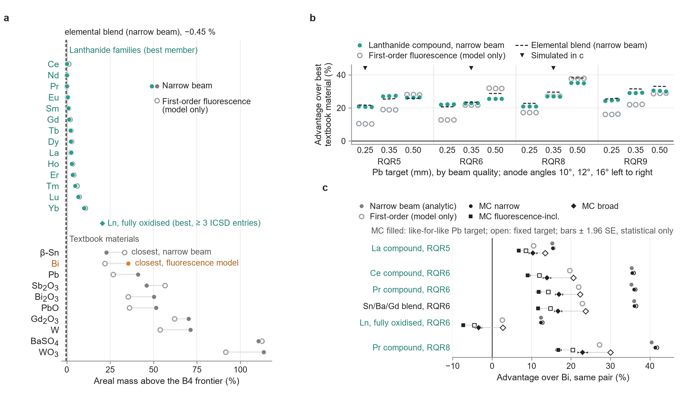

# Diagnostic plateau over the 36 variants and the first-order model markers

*The advantage per variant over all 36 RQR variants and the open first-order-model markers. The 36-variant statistics below are
also stated in the manuscript; they are collected here with the figure that shows them. Each number keeps its source row of the headline table
(`data/phase4b/headline_table_v3.csv`) in square brackets. Narrow beam unless stated otherwise; the main text of the
manuscript quotes the diagnostic advantage from the Monte Carlo spot check, not from the first-order model.*

## The 36 diagnostic variants

The four RQR qualities (RQR5, RQR6, RQR8, RQR9), three Pb targets (the narrow-beam transmission of 0.25, 0.35 and
0.50 mm Pb) and three anode angles (10°, 12°, 16°) give 36 variants. The reference beam is RQR6 at 12° behind 0.35 mm Pb.

## Narrow beam

- Across the 36 variants the narrow-beam advantage of the best lanthanide compound of the practical set over the best
  textbook material has a median of 26 % (range 21–35 %) [H84, H84:lo, H84:hi].
- A lanthanide compound leads every variant, but the compound changes: 10 different compounds lead the 36 variants
  (Supplementary Table S2(b) names them with their ICSD entries).
- Under narrow beam β-Sn is the closest textbook material at the reference beam (23 % above the frontier, against 35 %
  for Bi) [H168, H169]; it is the closest textbook material in 24 of the 36 variants, Bi in 7 and Gd₂O₃ in 5
  [H173, H310, H311].
- The best binary or ternary blend of the garment elements Sn, Sb, Bi, W, Ba and Gd (chosen per variant) lies within
  −2.5 to +1.4 % of the compound frontier over the 36 variants [H186:lo, H186:hi]; details in
  [Blends, fully oxidised filter and transparency threshold](blends_oxidised_threshold.md).
- On the areal-mass basis the median price over the 36 variants is 0 % for lead-free and for stability and 0.6 % for
  observation [H42, H43, H44]; lead-free is 0 % in every variant, and the largest values are 0.71 % for stability and
  1.9 % for observation [H42:hi, H43:hi, H44:hi]. The scarcity proxy's areal-mass price has a median of 1.6 % and
  reaches 8.0 % (bands up to 12 %) [H46, H176, H46:hi].

## First-order fluorescence model (model only)

The first-order model under-counts the escaping fluorescence against the Monte Carlo: by 19–27 % for single emitters
below the K edge [H242, H242:hi] and by 28–61 % for partner compounds [H244, H244:hi]
([Fluorescence model](fluorescence_model.md)). Its values are therefore biased high and are kept here only as the
markers in the figure below.

- Median advantage of the best lanthanide compound over the best textbook material across the 36 variants: 22 %
  (first-order model) [H83].
- At the reference beam the closest textbook material depends on the estimator: β-Sn under narrow beam (23 %), Bi under
  the fluorescence model (22 %) [H168, H170]; Bi is also the Monte Carlo reference.

*Panel b: advantage of the best lanthanide compound of the practical set over the best textbook material, per variant, for all
36 RQR variants (four qualities × three Pb targets × anode angles 10°, 12°, 16°). Narrow beam: median 26 % [H84].
First-order fluorescence model (grey, model only): median 22 % [H83]. Dashed: the best elemental blend over the same
textbook material, narrow beam; the blend lies within −2.5 to +1.4 % of the compound frontier over the 36 variants
[H186:lo, H186:hi]. Open grey markers at the reference beam: first-order model values of the families and textbook
materials.*
