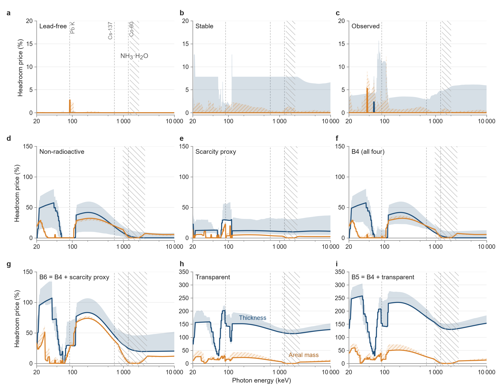

# Headroom prices and actinide headroom

*Each number keeps its source row of the headline table (`data/phase4b/headline_table_v3.csv`) in square brackets. Unless stated otherwise all values are narrow-beam, polymorph rule R2, coherent scattering included, frontier kind best_clean, and prices are B4-internal with thickness at the measured-density point.*

Prices measured against the unconstrained artefact-free frontier F0 measure headroom, the distance to the best compound in the whole map (figure below).
At the radionuclide lines that compound is an actinide, so headroom is not available in practical shielding.
Inside B4 the non-radioactive requirement is priced against B4 without it, whose thickness frontier at Cs-137 and Co-60 is α-Np metal; the resulting values are actinide headroom.
At Cs-137 it is 19 % on the thickness basis (α-Np to Ir; band 10–19 %) and 20 % on the areal-mass basis. [H01, H01:lo, H01:hi, H02]
At Co-60 it is 3.7 % on the thickness basis and 9.8 % on the areal-mass basis without hydrogen-containing compounds. [H13, H138]
At the diagnostic headline variant it is 56 % on the thickness basis and 5.6 % on the areal-mass basis; over the 36 variants the median areal-mass value is 1.7 %. [H25, H26, H41]
On single lines the thickness values reach 57 % at 20–63 keV (actinide K edges), 42 % at 63.5–300 keV and 38 % above 300 keV; the areal-mass values reach 32 %. [H47, stmt:H47, H48, stmt:H48, H49, stmt:H49, H50]
Depleted uranium metal is used as a dense photon shield (Yoshimura et al. 1996); the values measure how much thickness the non-radioactive requirement forgoes at the radionuclide lines, a headroom that buildable shielding does not offer.
Against F0, the whole practical set B4 is 19 % thicker than the unconstrained frontier at Cs-137 and 3.7 % at Co-60; B5 is 178 % and 139 % thicker, and B6 46 % and 24 % (headline table, rows A01–A36). [A07, A19, A09, A21, A11, A23]

*Headroom prices against the unconstrained artefact-free frontier F0, including the radioactive-element exclusion (actinide headroom). Panels: lead-free, stable, observed, non-radioactive, scarcity proxy, B4, B6 = B4 + scarcity proxy, transparent, B5 = B4 + transparent. best_clean, R2, narrow beam; thickness at the measured-density point; areal mass on the primary set at all energies. Grey-hatched ranges: NH₃·H₂O sets the areal frontier of the constrained set or of F0. Not the headline reference set.*

## References

- Yoshimura et al. 1996. Use of depleted uranium metal as cask shielding in high-level waste storage, transport, and disposal systems. https://doi.org/10.2172/414329
