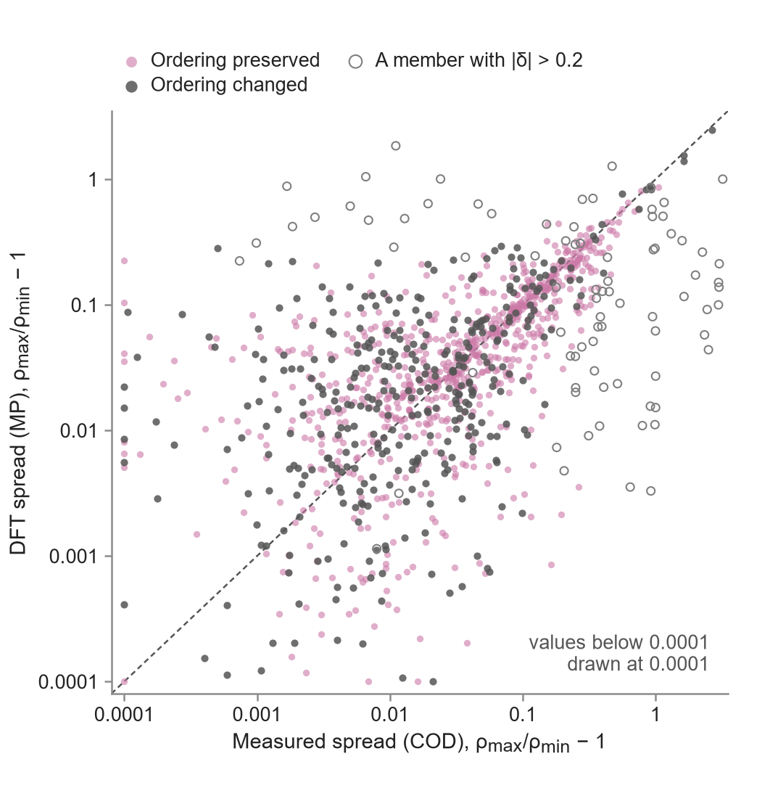

# Polymorph density spread

*Each number keeps its source row of the headline table (`data/phase4b/headline_table_v3.csv`) in square brackets. Unless stated otherwise all values are narrow-beam, polymorph rule R2, coherent scattering included, frontier kind best_clean, and prices are B4-internal with thickness at the measured-density point.*

Within the mixture rule polymorphs share μ/ρ and differ only through density (Hubbell 1999; Khattari 2024).
For 1 212 formulas with at least two Materials Project polymorphs matched to distinct COD structures, the median DFT density spread ρ_max/ρ_min − 1 is 3.7 % (figure below). [H81]
We are not aware of a prior population-level comparison of DFT-database polymorph density spreads with measured ones; it is consistent with the observation that many computed low-energy polymorphs are never observed (Zwijnenburg et al. 2010).
Ground-state DFT polymorph choices can differ from the ambient phase (Legrain and Manzhos 2016; Curnan and Kitchin 2015).
For Sn, rule R2 selects α-Sn, while the ambient phase β-Sn is 1.28 times as dense; the textbook comparison of Fig. 4 uses β-Sn. [H88]
This choice matters only on the thickness basis.

*Polymorph density spread, DFT (Materials Project) against measured (COD): ρ_max/ρ_min − 1 for 1 212 formulas with at least two MP polymorphs matched to distinct COD structures. Colour: the DFT ordering of the polymorph densities is preserved or changed. Open markers: a member with |δ| > 0.2. Dashed: equality. Summary statistics in row H81.*

## References

- Curnan and Kitchin 2015. Investigating the Energetic Ordering of Stable and Metastable TiO2 Polymorphs Using DFT+ U and Hybrid Functionals. The Journal of Physical Chemistry C 119, 21060-21071. https://doi.org/10.1021/acs.jpcc.5b05338
- Hubbell 1999. Review of photon interaction cross section data in the medical and biological context. Physics in Medicine and Biology 44, R1-R22. https://doi.org/10.1088/0031-9155/44/1/001
- Khattari 2024. Unveiling the influence of crystal structure polymorphs on radiation shielding properties: A case study of SiO$_2$. Journal of the American Ceramic Society 107, 3761--3768. https://doi.org/10.1111/jace.19736
- Legrain and Manzhos 2016. Understanding the difference in cohesive energies between alpha and beta tin in DFT calculations. AIP Advances 6. https://doi.org/10.1063/1.4948434
- Zwijnenburg et al. 2010. Apparent Scarcity of Low-Density Polymorphs of Inorganic Solids. Physical Review Letters 104. https://doi.org/10.1103/physrevlett.104.175503
