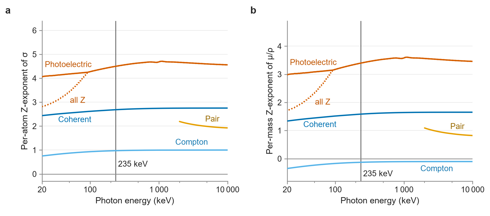

# Physics of the composition–density crossover and textbook Z-exponents

*Each number keeps its source row of the headline table (`data/phase4b/headline_table_v3.csv`) in square brackets. Unless stated otherwise all values are narrow-beam, polymorph rule R2, coherent scattering included, frontier kind best_clean, and prices are B4-internal with thickness at the measured-density point.*

The composition spread of μ across the map is carried by the photoelectric term and decays with it; the crossover at 235 keV is where that decaying spread meets the population's fixed density spread (figure below). [H79]
At the crossing the photoelectric term still carries 87 % of the variance of log μ/ρ, so the crossover is not where the photoelectric effect stops dominating. [H80]
The fitted Z-exponents reproduce known, energy-dependent photon-interaction systematics (White 1977) and are reported only as a consistency check.
Consistent with the steep Z-dependence of photoabsorption (White 1977; Hubbell 1999), the photoelectric term carries most of the composition spread at the crossover; this variance attribution is an accounting of the population, not a causal decomposition.
The energy dependence and Z-dependence of the partial cross sections are established (Hubbell 1999; White 1977); the map adds the location of the crossover for the catalogued inorganic population, which depends on how that population is weighted.

*Textbook Z-exponents behind the crossover: (a) the per-atom exponent n of σ ∝ Zⁿ; (b) the per-mass exponent of μ/ρ. Curves: photoelectric (K-active elements; dotted: all Z), Compton, coherent, and pair (≥ 2 MeV) cross sections across energy. The vertical line marks the population crossover at 235 keV [H79], where the photoelectric term still carries 87 % [H80] of var(log μ/ρ).*

## References

- Hubbell 1999. Review of photon interaction cross section data in the medical and biological context. Physics in Medicine and Biology 44, R1-R22. https://doi.org/10.1088/0031-9155/44/1/001
- White 1977. An analysis of the Z-dependence of photon and electron interactions. Physics in Medicine and Biology 22, 219-228. https://doi.org/10.1088/0031-9155/22/2/003
